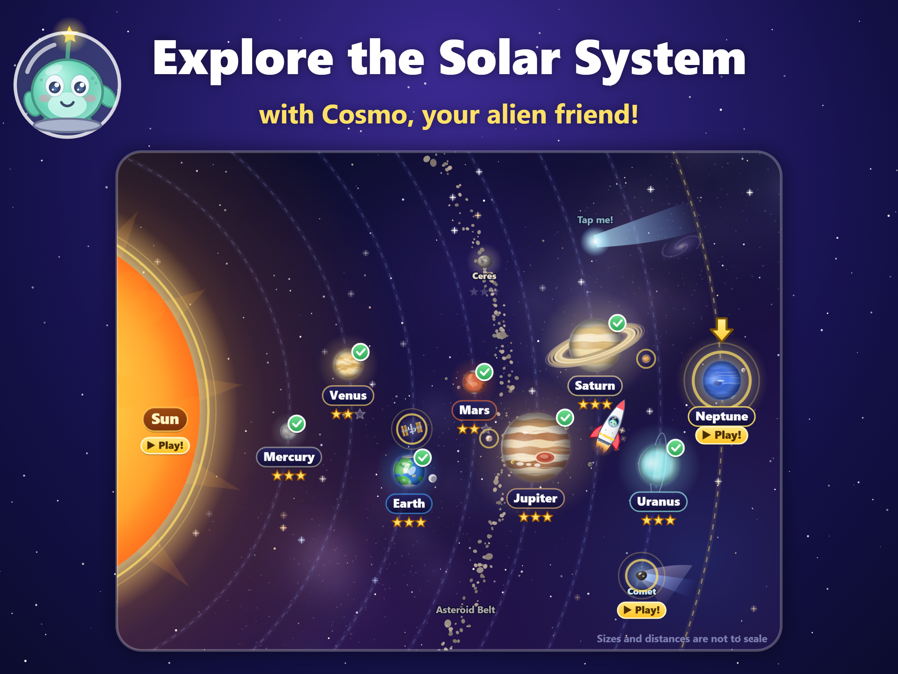
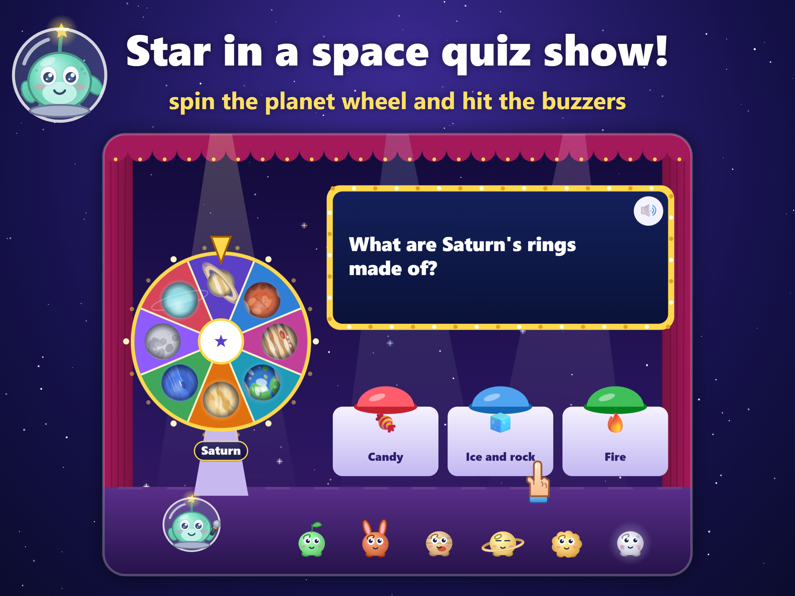
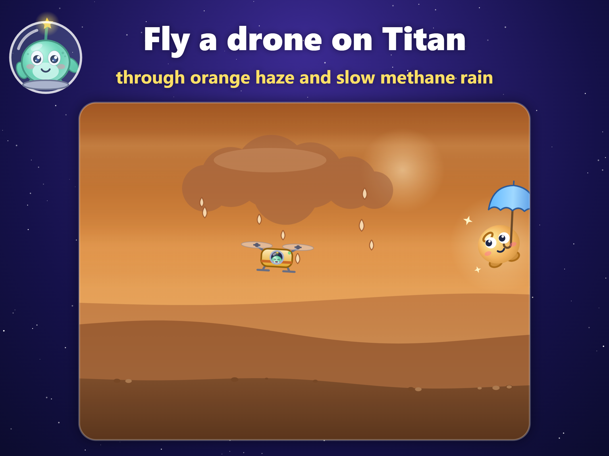
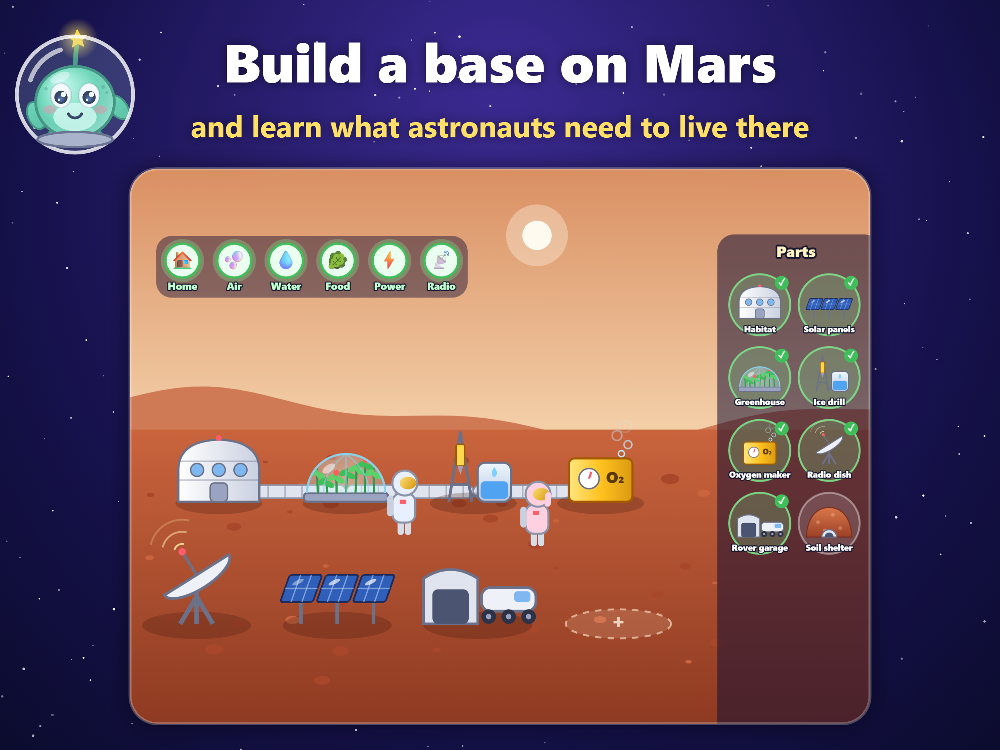

# Cosmo's Space Trip

**A hands-on Solar System game for kids aged 6–9.** Fly with Cosmo, a friendly little alien, to all eight planets. Every planet is a short mission that *is* its main science fact: you learn that Earth's spin makes day and night by spinning Earth yourself, and that Mars has weak gravity by floating a rover over boulders.

Built for iPad first (it works on iPhone too), in landscape, English only. No ads, no accounts, no data collection, and it works fully offline, so it fits Apple's Kids Category.

| | |
|---|---|
|  |  |
|  |  |

## What's inside
- **8 planet missions**, each with a picture quiz and a fact card, plus a harder **Expert** version of each for older kids.
- **Bonus missions:** Moon phases, the asteroid belt, the life of a star, a comet ride, the Space Station, Europa's ocean, a drone flight on Titan, Pluto and a trip to the black hole in the middle of the Milky Way.
- **Cosmo's Stage:** the *Mission Control* quiz show (alone, or as a family in two teams), **Space Camp** (a 3-minute daily astronaut routine), and two sing-alongs, the *Planet Song* and the *Moon Song*.
- **Toys:** a Mars Base builder, a Rocket Workshop, a gravity Playground, the Night Sky telescope (11 real constellations), a Space Journal with a real "Tonight's Moon" page, and a greenhouse.
- **Cosmo's world:** a Space Base to decorate with stickers, 16 shy critters to find, a wardrobe of hats and rocket paints, and postcards from Cosmo's family.
- **For grown-ups** (behind a parental gate): sound, music and read-aloud switches, *Little Explorer* mode (gentler missions), *Calm effects* (less flashing and shaking), Northern or Southern Hemisphere sky tips, and a "What your child learned" page.

### Design rules
- **No failure.** No lives, timers or game over. A wrong answer just says "try another one!"
- **Read-aloud everywhere.** Every line Cosmo says is spoken, with a 🔊 button to hear it again.
- **Accurate facts,** one short sentence each, checked as they are written.
- **Safe for kids.** No network calls, no external fonts or scripts, no ads, no analytics. Progress is saved only on the device.

## Play it in a browser
The game is plain HTML, CSS and JavaScript with no build step. Serve the folder with any static web server, for example from this folder:

```bash
python -m http.server 8124
```

On Windows you can use `py -m http.server 8124` instead. Then open <http://localhost:8124> and turn the window sideways (landscape). On a computer, Space jumps or continues.

## Project layout
| Path | Contents |
|---|---|
| `index.html`, `style.css` | The page, the HUD and the panels |
| `src/` | The game: one classic script per scene or system, all on the `window.SA` namespace (`main.js` boots it) |
| `docs/DESIGN.md` | The design brief and a log of every development round. **Start here.** |
| `docs/IOS_RELEASE.md` | Step-by-step guide to building and publishing the iOS app |
| `docs/APP_STORE_LISTING.md` | App Store text, ready to paste |
| `docs/index.html`, `docs/privacy-policy.html` | Support page and privacy policy (for GitHub Pages) |
| `resources/` | App icon and launch screen for the iOS build |
| `tools/screenshots.html` | Renders the App Store screenshots (iPhone 6.9" and iPad 13") |
| `tools/art.html` | Regenerates the icon and launch screen from the game's artwork |
| `screenshots/` | The current App Store screenshots |
| `scripts/` | Packaging helpers: copy the game into `www/`, configure the iOS project |
| `capacitor.config.json`, `codemagic.yaml` | iOS wrapper (Capacitor 7) and the cloud build that sends it to TestFlight |

## Building the iOS app
The app is wrapped with [Capacitor](https://capacitorjs.com/) and built on a cloud Mac by [Codemagic](https://codemagic.io/), so no Mac is needed. Follow **[docs/IOS_RELEASE.md](docs/IOS_RELEASE.md)**.

```bash
npm install        # Capacitor and its plugins
npm run build      # copies index.html, style.css and src/ into www/
```

`node_modules/`, `www/` and the generated `ios/` project are not stored in the repository.

## Privacy
The game makes no network requests and collects nothing. Saves live in the browser's local storage (or the app's own storage on iOS). See [docs/privacy-policy.html](docs/privacy-policy.html).
